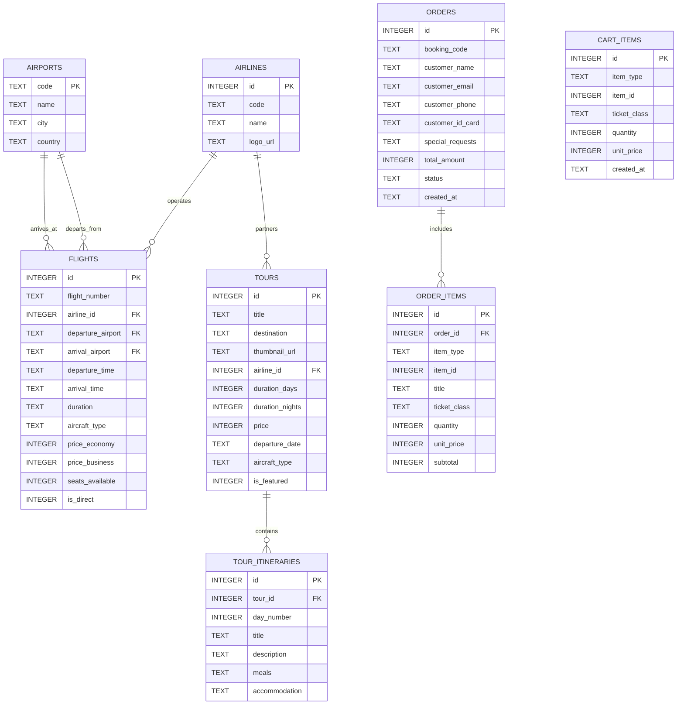

# DATABASE_SCHEMA.md - THIẾT KẾ CƠ SỞ DỮ LIỆU SQLITE TRÊN TRÌNH DUYỆT (SQL.JS WASM)
## DỰ ÁN: WEBSITE DU LỊCH & ĐẶT VÉ MÁY BAY VIETJET

---

## 1. TỔNG QUAN KIẾN TRÚC SQLITE CLIENT-SIDE (KHÔNG CẦN BACKEND)

Website hoạt động hoàn toàn ở phía client (Pure HTML, CSS, JavaScript). Để quản lý dữ liệu linh hoạt, hỗ trợ tìm kiếm, lọc và lưu trữ đơn hàng, dự án sử dụng **`sql.js`** — phiên bản SQLite được biên dịch sang **WebAssembly (WASM)**.

### 1.1. Cách thức hoạt động
1. **Nạp thư viện:** Trình duyệt tải `sql-wasm.js` và `sql-wasm.wasm` từ CDN (`cdnjs.cloudflare.com`).
2. **Khởi tạo Database:**
   - Hệ thống kiểm tra trong `localStorage` (hoặc `IndexedDB`) xem đã có file binary SQLite lưu từ trước hay chưa.
   - Nếu **đã có**: Khởi tạo `new SQL.Database(binaryData)`.
   - Nếu **chưa có** (lần đầu truy cập): Tạo database mới trong RAM, thực thi script `schema.sql` (tạo bảng) và `seed.sql` (nạp dữ liệu mẫu).
3. **Lưu trữ dữ liệu bền vững (Persistence):**
   - Mỗi khi người dùng thực hiện thao tác ghi (`INSERT`, `UPDATE`, `DELETE`) trên giỏ hàng hoặc đặt đơn hàng, hàm `db.export()` sẽ xuất ra mảng byte `Uint8Array`.
   - Lưu mảng byte này vào `localStorage` (hoặc `IndexedDB`) dưới dạng Base64 hoặc Blob.
   - Nhờ đó, khi người dùng chuyển trang (`index.html` sang `flights.html`, sang `cart.html`) hoặc F5 làm mới trình duyệt, toàn bộ giỏ hàng và dữ liệu vẫn được bảo toàn nguyên vẹn.

---

## 2. THIẾT KẾ CÁC BẢNG (DATABASE SCHEMA - DDL)



---

## 3. SQL DDL SCRIPTS (TẠO BẢNG)

```sql
-- 1. Bảng Hãng Hàng Không
CREATE TABLE IF NOT EXISTS airlines (
    id INTEGER PRIMARY KEY AUTOINCREMENT,
    code TEXT UNIQUE NOT NULL,
    name TEXT NOT NULL,
    logo_url TEXT NOT NULL
);

-- 2. Bảng Sân Bay
CREATE TABLE IF NOT EXISTS airports (
    code TEXT PRIMARY KEY,
    name TEXT NOT NULL,
    city TEXT NOT NULL,
    country TEXT NOT NULL DEFAULT 'Việt Nam'
);

-- 3. Bảng Chuyến Bay
CREATE TABLE IF NOT EXISTS flights (
    id INTEGER PRIMARY KEY AUTOINCREMENT,
    flight_number TEXT NOT NULL,
    airline_id INTEGER NOT NULL,
    departure_airport TEXT NOT NULL,
    arrival_airport TEXT NOT NULL,
    departure_time TEXT NOT NULL, -- HH:mm (vd: 06:15)
    arrival_time TEXT NOT NULL,   -- HH:mm (vd: 08:25)
    duration TEXT NOT NULL,       -- vd: 2h 10m
    aircraft_type TEXT NOT NULL,  -- vd: Airbus A321neo, Boeing 787-9
    price_economy INTEGER NOT NULL,
    price_business INTEGER NOT NULL,
    seats_available INTEGER NOT NULL DEFAULT 150,
    is_direct INTEGER NOT NULL DEFAULT 1, -- 1: Bay thẳng, 0: Quá cảnh
    baggage_info TEXT DEFAULT '7kg xách tay',
    meal_info TEXT DEFAULT 'Suất ăn nhẹ / Nước suối',
    FOREIGN KEY (airline_id) REFERENCES airlines(id),
    FOREIGN KEY (departure_airport) REFERENCES airports(code),
    FOREIGN KEY (arrival_airport) REFERENCES airports(code)
);

-- 4. Bảng Tour Du Lịch
CREATE TABLE IF NOT EXISTS tours (
    id INTEGER PRIMARY KEY AUTOINCREMENT,
    title TEXT NOT NULL,
    destination TEXT NOT NULL,
    thumbnail_url TEXT NOT NULL, -- Kích thước 600x400 px
    airline_id INTEGER NOT NULL,
    duration_days INTEGER NOT NULL,
    duration_nights INTEGER NOT NULL,
    price INTEGER NOT NULL,
    departure_date TEXT NOT NULL, -- YYYY-MM-DD
    aircraft_type TEXT NOT NULL,  -- Máy bay di chuyển
    departure_airport TEXT NOT NULL DEFAULT 'SGN',
    is_featured INTEGER NOT NULL DEFAULT 0, -- 1: Tour nổi bật trang chủ
    overview TEXT,
    FOREIGN KEY (airline_id) REFERENCES airlines(id)
);

-- 5. Bảng Lịch Trình Chi Tiết Từng Ngày Của Tour
CREATE TABLE IF NOT EXISTS tour_itineraries (
    id INTEGER PRIMARY KEY AUTOINCREMENT,
    tour_id INTEGER NOT NULL,
    day_number INTEGER NOT NULL,
    title TEXT NOT NULL,
    description TEXT NOT NULL,
    meals TEXT,
    accommodation TEXT,
    FOREIGN KEY (tour_id) REFERENCES tours(id)
);

-- 6. Bảng Giỏ Hàng (Lưu trạng thái tạm của khách hàng)
CREATE TABLE IF NOT EXISTS cart_items (
    id INTEGER PRIMARY KEY AUTOINCREMENT,
    item_type TEXT NOT NULL CHECK(item_type IN ('flight', 'tour')),
    item_id INTEGER NOT NULL,
    ticket_class TEXT DEFAULT 'economy', -- 'economy' | 'business' | 'standard'
    quantity INTEGER NOT NULL DEFAULT 1,
    unit_price INTEGER NOT NULL,
    created_at DATETIME DEFAULT CURRENT_TIMESTAMP
);

-- 7. Bảng Đơn Hàng / Đặt Chỗ
CREATE TABLE IF NOT EXISTS orders (
    id INTEGER PRIMARY KEY AUTOINCREMENT,
    booking_code TEXT UNIQUE NOT NULL,
    customer_name TEXT NOT NULL,
    customer_email TEXT NOT NULL,
    customer_phone TEXT NOT NULL,
    customer_id_card TEXT NOT NULL,
    special_requests TEXT,
    total_amount INTEGER NOT NULL,
    status TEXT NOT NULL DEFAULT 'CONFIRMED',
    created_at DATETIME DEFAULT CURRENT_TIMESTAMP
);

-- 8. Bảng Chi Tiết Đơn Hàng
CREATE TABLE IF NOT EXISTS order_items (
    id INTEGER PRIMARY KEY AUTOINCREMENT,
    order_id INTEGER NOT NULL,
    item_type TEXT NOT NULL,
    item_id INTEGER NOT NULL,
    title TEXT NOT NULL,
    ticket_class TEXT,
    quantity INTEGER NOT NULL,
    unit_price INTEGER NOT NULL,
    subtotal INTEGER NOT NULL,
    FOREIGN KEY (order_id) REFERENCES orders(id)
);
```

---

## 4. DỮ LIỆU KHỞI TẠO MẪU (SEED DATA SCRIPT)

```sql
-- Dữ liệu Hãng hàng không
INSERT INTO airlines (id, code, name, logo_url) VALUES 
(1, 'VJ', 'VietJet Air', 'https://upload.wikimedia.org/wikipedia/commons/thumb/d/d4/VietJet_Air_logo.svg/320px-VietJet_Air_logo.svg.png'),
(2, 'VN', 'Vietnam Airlines', 'https://upload.wikimedia.org/wikipedia/commons/thumb/c/cf/Vietnam_Airlines_logo.svg/320px-Vietnam_Airlines_logo.svg.png'),
(3, 'SQ', 'Singapore Airlines', 'https://upload.wikimedia.org/wikipedia/en/thumb/6/6b/Singapore_Airlines_Logo_2.svg/320px-Singapore_Airlines_Logo_2.svg.png'),
(4, 'QH', 'Bamboo Airways', 'https://upload.wikimedia.org/wikipedia/commons/thumb/2/29/Bamboo_Airways_logo.svg/320px-Bamboo_Airways_logo.svg.png'),
(5, 'QR', 'Qatar Airways', 'https://upload.wikimedia.org/wikipedia/en/thumb/9/9b/Qatar_Airways_Logo.svg/320px-Qatar_Airways_Logo.svg.png');

-- Dữ liệu Sân bay
INSERT INTO airports (code, name, city, country) VALUES
('SGN', 'Sân bay Quốc tế Tân Sơn Nhất', 'TP. Hồ Chí Minh', 'Việt Nam'),
('HAN', 'Sân bay Quốc tế Nội Bài', 'Hà Nội', 'Việt Nam'),
('DAD', 'Sân bay Quốc tế Đà Nẵng', 'Đà Nẵng', 'Việt Nam'),
('CXR', 'Sân bay Quốc tế Cam Ranh', 'Nha Trang', 'Việt Nam'),
('PQC', 'Sân bay Quốc tế Phú Quốc', 'Phú Quốc', 'Việt Nam'),
('SIN', 'Sân bay Quốc tế Changi', 'Singapore', 'Singapore'),
('BKK', 'Sân bay Quốc tế Suvarnabhumi', 'Bangkok', 'Thái Lan');

-- Dữ liệu Chuyến bay mẫu
INSERT INTO flights (flight_number, airline_id, departure_airport, arrival_airport, departure_time, arrival_time, duration, aircraft_type, price_economy, price_business, seats_available, is_direct, baggage_info, meal_info) VALUES
('VJ-120', 1, 'SGN', 'HAN', '05:30', '07:40', '2h 10m', 'Airbus A321neo', 1190000, 3690000, 45, 1, '7kg xách tay', 'Suất ăn mua thêm'),
('VJ-128', 1, 'SGN', 'HAN', '08:15', '10:25', '2h 10m', 'Airbus A321neo', 1450000, 3890000, 32, 1, '7kg xách tay', 'Suất ăn mua thêm'),
('VN-210', 2, 'SGN', 'HAN', '09:00', '11:15', '2h 15m', 'Boeing 787-9 Dreamliner', 1890000, 4850000, 20, 1, '12kg xách tay + 23kg ký gửi', 'Bữa ăn nóng miễn phí'),
('VJ-152', 1, 'SGN', 'HAN', '14:30', '16:40', '2h 10m', 'Airbus A330-300', 1350000, 3750000, 50, 1, '7kg xách tay', 'Suất ăn mua thêm'),
('QH-204', 4, 'SGN', 'HAN', '16:00', '18:10', '2h 10m', 'Airbus A320', 1520000, 4100000, 25, 1, '7kg xách tay + 20kg ký gửi', 'Snack & Nước khoáng'),
('VJ-168', 1, 'SGN', 'HAN', '20:15', '22:25', '2h 10m', 'Airbus A321neo', 1090000, 3490000, 60, 1, '7kg xách tay', 'Suất ăn mua thêm'),
('VN-246', 2, 'SGN', 'HAN', '21:30', '23:45', '2h 15m', 'Airbus A350-900', 1790000, 4690000, 18, 1, '12kg xách tay + 23kg ký gửi', 'Bữa ăn nhẹ miễn phí'),
-- Tuyến SGN - DAD
('VJ-622', 1, 'SGN', 'DAD', '06:45', '08:05', '1h 20m', 'Airbus A320', 890000, 2890000, 40, 1, '7kg xách tay', 'Nước khoáng'),
('VN-112', 2, 'SGN', 'DAD', '10:15', '11:40', '1h 25m', 'Airbus A321', 1350000, 3450000, 25, 1, '12kg xách tay + 23kg ký gửi', 'Snack & Nước ngọt'),
('VJ-628', 1, 'SGN', 'DAD', '15:20', '16:40', '1h 20m', 'Airbus A321neo', 990000, 2990000, 35, 1, '7kg xách tay', 'Nước khoáng'),
-- Tuyến SGN - PQC
('VJ-321', 1, 'SGN', 'PQC', '07:30', '08:35', '1h 05m', 'Airbus A321', 790000, 2490000, 55, 1, '7kg xách tay', 'Nước khoáng'),
('VN-1823', 2, 'SGN', 'PQC', '11:00', '12:05', '1h 05m', 'Airbus A321', 1250000, 3100000, 30, 1, '12kg xách tay + 23kg ký gửi', 'Snack & Nước khoáng'),
-- Tuyến Quốc Tế SGN - SIN
('SQ-178', 3, 'SGN', 'SIN', '09:25', '12:35', '2h 10m', 'Boeing 787-10', 3200000, 8900000, 15, 1, '7kg xách tay + 25kg ký gửi', 'Bữa ăn nóng tiêu chuẩn 5 sao'),
('VJ-813', 1, 'SGN', 'SIN', '13:50', '16:55', '2h 05m', 'Airbus A321neo', 1690000, 4990000, 42, 1, '7kg xách tay', 'Suất ăn mua thêm'),
-- Tuyến Quốc Tế SGN - BKK
('VJ-801', 1, 'SGN', 'BKK', '08:45', '10:15', '1h 30m', 'Airbus A321', 1450000, 4200000, 38, 1, '7kg xách tay', 'Nước khoáng');

-- Dữ liệu 8 Tour Du Lịch Nổi Bật (Trang chủ) & Các Tour Khác
INSERT INTO tours (id, title, destination, thumbnail_url, airline_id, duration_days, duration_nights, price, departure_date, aircraft_type, is_featured, overview) VALUES
(1, 'Đà Nẵng - Bà Nà Hills - Cầu Vàng - Phố Cổ Hội An', 'Đà Nẵng & Quảng Nam', 'https://images.unsplash.com/photo-1559592413-7cec4d0cae2b?w=600&h=400&fit=crop', 1, 4, 3, 4590000, '2026-11-20', 'Airbus A321neo', 1, 'Khám phá thành phố đáng sống nhất Việt Nam, check-in Cầu Vàng Bà Nà Hills và vẻ đẹp lung linh của Phố cổ Hội An về đêm.'),
(2, 'Phú Quốc - Thiên Đường Đảo Ngọc - Grand World - Cáp Treo Hòn Thơm', 'Kiên Giang', 'https://images.unsplash.com/photo-1540959733332-eab4deabeeaf?w=600&h=400&fit=crop', 1, 3, 2, 3890000, '2026-11-22', 'Airbus A321', 1, 'Tận hưởng bãi biển xanh ngắt, chiêm ngưỡng thành phố không ngủ Grand World và trải nghiệm tuyến cáp treo vượt biển dài nhất thế giới.'),
(3, 'Nha Trang - Vịnh San Hô - VinWonders - Tháp Bà Ponagar', 'Khánh Hòa', 'https://images.unsplash.com/photo-1507525428034-b723cf961d3e?w=600&h=400&fit=crop', 1, 4, 3, 4190000, '2026-11-25', 'Airbus A320', 1, 'Hòa mình vào vịnh biển đẹp nhất thế giới, vui chơi thả ga tại VinWonders và khám phá văn hóa Chăm Pa cổ kính.'),
(4, 'Bangkok - Pattaya - Chợ Nổi Bốn Miền - Đảo San Hô Coral', 'Thái Lan', 'https://images.unsplash.com/photo-1508009603885-50cf7c579365?w=600&h=400&fit=crop', 1, 5, 4, 6990000, '2026-11-28', 'Airbus A321neo', 1, 'Hành trình xứ sở Chùa Vàng khám phá chùa Wat Arun, thành phố không ngủ Pattaya và thưởng thức ẩm thực đường phố đặc sắc.'),
(5, 'Singapore - Công Viên Sư Tử Biển - Gardens by the Bay - Đảo Sentosa', 'Singapore', 'https://images.unsplash.com/photo-1525625293386-3f8f99389edd?w=600&h=400&fit=crop', 3, 4, 3, 10890000, '2026-12-02', 'Boeing 787-10', 1, 'Khám phá đảo quốc sư tử hiện đại bậc nhất châu Á, chiêm ngưỡng siêu cây ánh sáng tại Gardens by the Bay và Universal Studios.'),
(6, 'Hà Nội - Vịnh Hạ Long - Sapa Fansipan Nóc Nhà Đông Dương', 'Miền Bắc', 'https://images.unsplash.com/photo-1528127269322-539801943592?w=600&h=400&fit=crop', 2, 5, 4, 7590000, '2026-12-05', 'Boeing 787-9 Dreamliner', 1, 'Du thuyền trên Vịnh Hạ Long kỳ quan thế giới, săn mây trên đỉnh Fansipan hùng vĩ và trải nghiệm nét đẹp nghìn năm văn hiến Thủ đô.'),
(7, 'Bali - Đảo Thiên Đường - Cổng Trời Lempuyang - Thác Tegenungan', 'Indonesia', 'https://images.unsplash.com/photo-1537996194471-e657df975ab4?w=600&h=400&fit=crop', 1, 4, 3, 9490000, '2026-12-10', 'Airbus A321', 1, 'Check-in cổng trời Lempuyang huyền thoại, đu xích đu Bali Swing giữa rừng nhiệt đới và ngắm hoàng hôn vịnh Jimbaran.'),
(8, 'Tokyo - Núi Phú Sĩ - Làng Cổ Oshino Hakkai - Tháp Tokyo Skytree', 'Nhật Bản', 'https://images.unsplash.com/photo-1503899036084-c55cdd92da26?w=600&h=400&fit=crop', 2, 6, 5, 26900000, '2026-12-15', 'Airbus A350-900', 1, 'Chiêm ngưỡng núi Phú Sĩ biểu tượng nước Nhật, dạo bước giữa khu phố cổ Asakusa và mua sắm sầm uất tại Shinjuku, Ginza.');

-- Lịch trình chi tiết cho Tour 1: Đà Nẵng - Hội An
INSERT INTO tour_itineraries (tour_id, day_number, title, description, meals, accommodation) VALUES
(1, 1, 'TP.HCM - Đà Nẵng - Bán Đảo Sơn Trà - Biển Mỹ Khê', 'Xe và HDV đón quý khách tại Sân bay Tân Sơn Nhất đáp chuyến bay Vietjet đi Đà Nẵng. Đến nơi xe đưa quý khách viếng Chùa Linh Ứng Bãi Bụt, ngắm tượng Phật Bà Quan Âm 67m, tự do tắm biển Mỹ Khê.', 'Trưa, Tối', 'Khách sạn 4 sao gần biển'),
(1, 2, 'Khu Du Lịch Bà Nà Hills - Cầu Vàng - Check-in Làng Pháp', 'Khởi hành đi Bà Nà Hills, đi cáp treo đạt 4 kỷ lục thế giới. Dạo bước trên Cầu Vàng độc đáo, tham quan vườn hoa Le Jardin D''Amour, khu hầm rượu cổ Debay và công viên Fantasy Park.', 'Sáng, Trưa buffet, Tối', 'Khách sạn 4 sao trung tâm'),
(1, 3, 'Ngũ Hành Sơn - Làng Đá Mỹ Nghệ Non Nước - Phố Cổ Hội An', 'Tham quan danh thắng Ngũ Hành Sơn, Động Huyền Không. Chiều khởi hành đi Phố Cổ Hội An, dạo bộ ngắm đèn lồng, Chùa Cầu Nhật Bản, nhà cổ Phùng Hưng, thưởng thức Cao Lầu.', 'Sáng, Trưa, Tối', 'Khách sạn 4 sao trung tâm'),
(1, 4, 'Chợ Hàn Đà Nẵng - Mua Sắm Đặc Sản - Tiễn Sân Bay Về TP.HCM', 'Quý khách tự do đi dạo, mua sắm hải sản khô, bánh tráng cuốn thịt heo tại Chợ Hàn. Xe đưa đoàn ra Sân bay Đà Nẵng làm thủ tục về lại TP.HCM. Kết thúc chuyến đi tốt đẹp.', 'Sáng, Trưa', 'Về lại TP.HCM');

-- Lịch trình chi tiết cho Tour 2: Phú Quốc Đảo Ngọc
INSERT INTO tour_itineraries (tour_id, day_number, title, description, meals, accommodation) VALUES
(2, 1, 'TP.HCM - Phú Quốc - Grand World Thành Phố Không Ngủ', 'Đoàn đón chuyến bay sáng đi Phú Quốc. Tham quan Dinh Cậu, Suối Tranh. Buổi chiều khám phá Grand World, xem show diễn Sắc Màu Venice và Tinh Hoa Việt Nam.', 'Trưa, Tối', 'Resort 4 sao sát biển'),
(2, 2, 'Tour Canô 4 Đảo - Cáp Treo Hòn Thơm - Sunset Sanato', 'Trải nghiệm canô tham quan Hòn Mây Rút, Hòn Gầm Ghì lặn ngắm san hô. Đi tuyến cáp treo vượt biển 3 dây Hòn Thơm, ngắm hoàng hôn tuyệt đẹp tại Sunset Sanato.', 'Sáng, Trưa hải sản, Tối', 'Resort 4 sao sát biển'),
(2, 3, 'Nhà Tù Phú Quốc - Vườn Tiêu - Mua Sắm - Tiễn Bay', 'Tham quan di tích lịch sử Nhà tù Phú Quốc, cơ sở nuôi cấy ngọc trai cao cấp và xưởng sản xuất nước mắm truyền thống. Xe đưa đoàn ra sân bay về lại TP.HCM.', 'Sáng, Trưa', 'Về lại TP.HCM');
```

---

## 5. THIẾT KẾ MODULE JAVASCRIPT QUẢN TRỊ CƠ SỞ DỮ LIỆU (`database.js`)

Dưới đây là mã nguồn chuẩn giúp Antigravity sinh file `js/db/database.js` để kết nối SQLite thông qua CDN:

```javascript
/**
 * database.js - Wrapper SQLite WebAssembly qua sql.js
 */
const DB_STORAGE_KEY = 'vietjet_sqlite_db_v1';

class VietjetDatabase {
    constructor() {
        this.db = null;
        this.isReady = false;
    }

    async init() {
        if (this.isReady) return this.db;

        // 1. Tải thư viện sql.js từ WebAssembly CDN
        const SQL = await initSqlJs({
            locateFile: file => `https://cdnjs.cloudflare.com/ajax/libs/sql.js/1.8.0/${file}`
        });

        // 2. Kiểm tra dữ liệu đã lưu trong localStorage
        const savedDb = localStorage.getItem(DB_STORAGE_KEY);
        if (savedDb) {
            try {
                // Chuyển chuỗi base64 thành mảng Uint8Array
                const binaryString = atob(savedDb);
                const bytes = new Uint8Array(binaryString.length);
                for (let i = 0; i < binaryString.length; i++) {
                    bytes[i] = binaryString.charCodeAt(i);
                }
                this.db = new SQL.Database(bytes);
                this.isReady = true;
                console.log('✅ Khôi phục SQLite Database từ LocalStorage thành công');
                return this.db;
            } catch (err) {
                console.warn('⚠️ Lỗi khi đọc DB cũ, sẽ tạo lại DB mới:', err);
            }
        }

        // 3. Nếu chưa có DB, khởi tạo DB mới và nạp DDL + Seed
        this.db = new SQL.Database();
        await this.runInitialScripts();
        this.save();
        this.isReady = true;
        console.log('✅ Khởi tạo SQLite Database & nạp Seed Data mới thành công');
        return this.db;
    }

    async runInitialScripts() {
        // Chạy Schema DDL và Dữ liệu mẫu khởi tạo
        this.db.run(SCHEMA_SQL);
        this.db.run(SEED_SQL);
    }

    save() {
        if (!this.db) return;
        try {
            const data = this.db.export();
            let binary = '';
            for (let i = 0; i < data.byteLength; i++) {
                binary += String.fromCharCode(data[i]);
            }
            localStorage.setItem(DB_STORAGE_KEY, btoa(binary));
        } catch (e) {
            console.error('Không thể lưu Database vào LocalStorage:', e);
        }
    }

    // Tiện ích truy vấn trả về mảng Objects dễ sử dụng
    query(sql, params = []) {
        if (!this.db) throw new Error('Database chưa được khởi tạo!');
        const stmt = this.db.prepare(sql);
        stmt.bind(params);
        const results = [];
        while (stmt.step()) {
            results.push(stmt.getAsObject());
        }
        stmt.free();
        return results;
    }

    // Tiện ích thực thi lệnh INSERT/UPDATE/DELETE và tự động lưu
    execute(sql, params = []) {
        if (!this.db) throw new Error('Database chưa được khởi tạo!');
        this.db.run(sql, params);
        this.save(); // Tự động lưu sau mỗi thay đổi
        return true;
    }
}

export const dbInstance = new VietjetDatabase();
```
