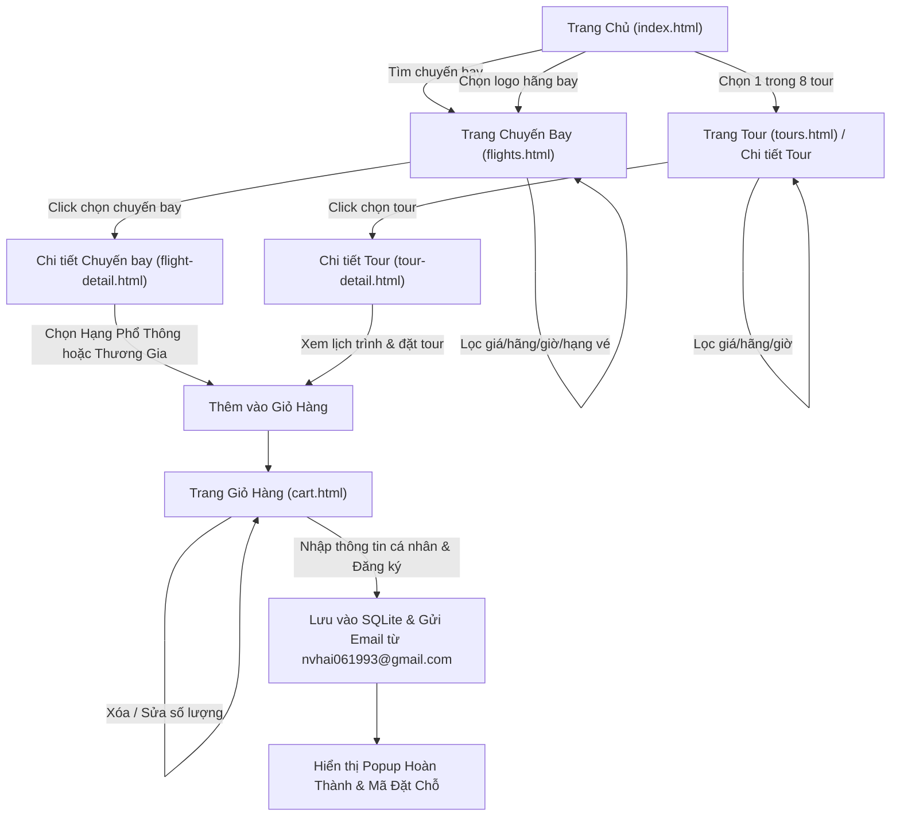

# PRD.md - TÀI LIỆU YÊU CẦU SẢN PHẨM (PRODUCT REQUIREMENTS DOCUMENT)
## DỰ ÁN: WEBSITE DU LỊCH & ĐẶT VÉ MÁY BAY VIETJET

---

## 1. GIỚI THIỆU & MỤC TIÊU DỰ ÁN

### 1.1. Mục tiêu
Xây dựng một website du lịch và đặt vé máy bay hiện đại mang thương hiệu **Vietjet**, cho phép khách hàng tra cứu chuyến bay, khám phá tour du lịch, xem chi tiết hành trình, lựa chọn hạng vé, quản lý giỏ hàng và đặt dịch vụ với cơ chế xác nhận đơn hàng gửi email trực tiếp tới khách hàng.

### 1.2. Ràng buộc kỹ thuật cốt lõi
- **Không có backend:** 100% ứng dụng chạy tĩnh trên trình duyệt (Pure HTML5, CSS3, Vanilla JavaScript).
- **Cơ sở dữ liệu:** **SQLite** chạy trực tiếp trong trình duyệt thông qua **sql.js (WebAssembly)**, tự động lưu trạng thái vào `IndexedDB` hoặc `localStorage`.
- **Giao diện thương hiệu:** Nền sáng, màu trắng làm chủ đạo kết hợp màu đỏ thương hiệu Vietjet (`#ee1d23`) và màu nhấn vàng (`#ffc107`).
- **Gửi Email tự động:** Tích hợp EmailJS từ client, đại diện gửi từ `nvhai061993@gmail.com` tới email khách hàng khi đăng ký thành công.

---

## 2. PHÂN TÍCH LUỒNG NGƯỜI DÙNG (USER FLOW)

---

## 3. CHI TIẾT YÊU CẦU CÁC TRANG & CHỨC NĂNG

### 3.1. Trang Chủ (`index.html`)

#### A. Header & Thanh Điều Hướng (Navigation Bar)
- **Logo:** Hiển thị logo thương hiệu Vietjet (dẫn nguồn từ file `images/Logo.jpg`).
- **Menu liên kết:**
  - Trang chủ (`index.html`)
  - Chuyến bay (`flights.html`)
  - Tour du lịch (`tours.html`)
  - Giỏ hàng (`cart.html`) có biểu tượng giỏ hàng và **Badge đếm số lượng mục đã chọn** (cập nhật real-time từ database/localStorage).
  - Hotline hỗ trợ: `1900 1886` hoặc email liên hệ.

#### B. Khung Tìm Kiếm Chuyến Bay (Flight Search Widget)
Nằm nổi bật trên ảnh nền banner `images/plane.jpg`:
1. **Loại vé (Radio Button / Tabs):**
   - Vé khứ hồi (Round-trip)
   - Vé một chiều (One-way)
2. **Điểm xuất phát (Origin):** Dropdown/Datalist chọn thành phố/sân bay (Hà Nội - HAN, TP. Hồ Chí Minh - SGN, Đà Nẵng - DAD, Nha Trang - CXR, Phú Quốc - PQC, Singapore - SIN, Bangkok - BKK...).
3. **Điểm đến (Destination):** Dropdown/Datalist chọn điểm đến. Có nút đổi chiều điểm đi - điểm đến nhanh.
4. **Ngày khởi hành (Departure Date):** Date picker chọn ngày (mặc định ngày hiện tại hoặc ngày kế tiếp).
5. **Ngày về (Return Date):** Date picker chọn ngày về. Bị vô hiệu hóa (disabled) nếu người dùng chọn vé "Một chiều".
6. **Số hành khách:** Bộ đếm số người lớn (Adult), trẻ em (Child).
7. **Nút "Tìm Kiếm Chuyến Bay":** Khi nhấn, thu thập toàn bộ tham số tìm kiếm và chuyển hướng sang trang `flights.html` với URL Query parameters (Ví dụ: `flights.html?trip=round&from=SGN&to=HAN&dep=2026-11-15&ret=2026-11-20&pax=1`).

#### C. Phần Tour Du Lịch Nổi Bật (8 Tour Featured)
- Tiêu đề mục: **"Tour Du Lịch Nổi Bật - Giá Tốt Nhất"** kèm mô tả ngắn.
- Hiển thị danh sách **đúng 8 tour du lịch đặc sắc** (truy vấn từ SQLite với điều kiện `is_featured = 1 LIMIT 8`):
  - Kích thước ảnh đại diện thumbnail chuẩn: **600x400 px** (tỉ lệ 3:2), bo góc 8px, hiệu ứng zoom nhẹ khi hover.
  - Tên tour du lịch (ví dụ: *Đà Nẵng - Bà Nà Hills - Hội An 4N3Đ*, *Phú Quốc Thiên Đường Đảo Ngọc 3N2Đ*, *Bangkok - Pattaya Thái Lan 5N4Đ*...).
  - Tên hãng du lịch/hàng không đồng hành (Vietjet Travel, Vietnam Airlines...).
  - Thời lượng tour: Số ngày / đêm (ví dụ: `4 Ngày 3 Đêm`).
  - Giá tour: Hiển thị giá nổi bật màu đỏ đậm `#ee1d23` (ví dụ: `4.590.000 đ`).
  - Nút "Xem Tour" hoặc nhấp toàn bộ card -> Chuyển hướng tới trang `tours.html` hoặc `tour-detail.html?id=[tour_id]`.

#### D. Phần Hãng Hàng Không Đối Tác
- Tiêu đề mục: **"Các Hãng Hàng Không Đồng Hành"**.
- Danh sách logo & tên các hãng hàng không tiêu biểu:
  - VietJet Air
  - Vietnam Airlines
  - Singapore Airlines
  - Bamboo Airways
  - Qatar Airways
  - Thai Airways
- **Hành vi tương tác:** Khi người dùng nhấp vào logo của một hãng bay bất kỳ, hệ thống lập tức chuyển hướng sang trang Chuyến Bay (`flights.html?airline=[mã_hãng]`) và tự động kích hoạt bộ lọc của hãng đó.

#### E. Footer (Chân trang)
- Thông tin doanh nghiệp: Vietjet Travel, địa chỉ, giấy phép kinh doanh lữ hành.
- Email liên hệ hỗ trợ: `nvhai061993@gmail.com`.
- Bản quyền, phương thức thanh toán hỗ trợ, liên kết chính sách bảo mật & điều khoản sử dụng.

---

### 3.2. Trang Chuyến Bay (`flights.html`)

Trang hiển thị danh sách các chuyến bay với bố cục chia thành 2 cột rõ ràng:

#### A. Cột bên trái: Bộ lọc đa năng (Filter Sidebar)
1. **Sắp xếp giá vé:**
   - Giá tăng dần (Mặc định - giá rẻ nhất lên đầu)
   - Giá giảm dần
   - Giờ cất cánh sớm nhất
2. **Loại vé & Chặng bay:**
   - Vé khứ hồi
   - Vé một chiều
   - Bay thẳng (Direct flight)
   - Nhiều thành phố (Multi-city)
3. **Các hãng hàng không:**
   - Danh sách checkbox cho từng hãng: VietJet Air, Vietnam Airlines, Singapore Airlines, Bamboo Airways... Kèm số lượng chuyến bay tìm thấy của mỗi hãng.
4. **Thời gian cất cánh (Khung giờ trong ngày):**
   - Buổi sáng sớm (00:00 - 06:00)
   - Buổi sáng (06:00 - 12:00)
   - Buổi chiều (12:00 - 18:00)
   - Buổi tối (18:00 - 24:00)
5. **Hạng dịch vụ:**
   - Hạng Phổ Thông (Economy)
   - Hạng Thương Gia (Business / SkyBoss)
6. **Nút "Đặt lại bộ lọc" (Reset Filter):** Xóa tất cả tiêu chí và hiển thị lại toàn bộ kết quả.

#### B. Cột bên phải: Danh sách chuyến bay (Flight Listings)
- Thanh tóm tắt kết quả: Số lượng chuyến bay tìm thấy, chặng bay đang tìm (ví dụ: *TP. Hồ Chí Minh (SGN) → Hà Nội (HAN)*).
- Thẻ chuyến bay (Flight Card) chi tiết:
  - Logo hãng hàng không + Tên hãng + Số hiệu chuyến bay (ví dụ: `VJ-128`, `VN-246`).
  - Thông tin thời gian:
    - Giờ cất cánh (sân bay đi).
    - Biểu đồ thời gian bay (thời lượng, ví dụ `2h 10m`, nhãn "Bay thẳng").
    - Giờ hạ cánh (sân bay đến).
  - Dịch vụ kèm theo dạng badge: 7kg hành lý xách tay, 20kg hành lý ký gửi, suất ăn nóng, wifi trên chuyến bay...
  - Giá tiền: Giá vé thấp nhất hiển thị to rõ bằng màu đỏ `#ee1d23` (ví dụ: `1.290.000 đ`).
  - Nút bấm hành động: **"Chọn chuyến bay"** -> Chuyển hướng sang trang Chi tiết Chuyến Bay (`flight-detail.html?id=[flight_id]`).

---

### 3.3. Trang Chi Tiết Chuyến Bay (`flight-detail.html`)

Hiển thị toàn bộ thông số chi tiết của chuyến bay và bảng so sánh lựa chọn hạng vé.

#### A. Chi tiết hành trình bay
- Điểm xuất phát (Sân bay đi, Thành phố, Nhà ga Terminal).
- Điểm đến (Sân bay đến, Thành phố, Nhà ga Terminal).
- Ngày bay, Giờ cất cánh và Giờ hạ cánh dự kiến.
- Hãng hàng không phụ trách & Logo.
- Số hiệu chuyến bay.
- **Loại máy bay:** Hiển thị rõ loại tàu bay khai thác (ví dụ: *Airbus A321neo*, *Boeing 787-9 Dreamliner*, *Airbus A330-300*...).
- Thời gian bay tổng cộng.

#### B. Lựa chọn Hạng Vé (Ticket Class Selector)
Thiết kế gồm 2 khối thẻ so sánh rõ rệt:
1. **Hạng Phổ Thông (Economy / Eco):**
   - Giá vé (ví dụ: `1.290.000 đ`).
   - Quyền lợi bao gồm:
     - 07 kg hành lý xách tay tiêu chuẩn.
     - Ghế ngồi tiêu chuẩn, thoải mái.
     - Nước suối miễn phí.
     - Thay đổi ngày/giờ bay có tính phí chênh lệch.
   - Nút lựa chọn: "Chọn Hạng Phổ Thông".
2. **Hạng Thương Gia (Business / SkyBoss):**
   - Giá vé (ví dụ: `3.890.000 đ`).
   - Quyền lợi cao cấp:
     - 14 kg hành lý xách tay + 30 kg hành lý ký gửi miễn phí.
     - Sử dụng Phòng chờ thương gia (Business Lounge) sang trọng.
     - Lối đi ưu tiên làm thủ tục & qua cửa an ninh.
     - Suất ăn nóng cao cấp tự chọn kèm đồ uống đặc biệt.
     - Ghế da ngả lưng rộng rãi hoặc giường phẳng.
     - Miễn phí thay đổi hành trình / ngày bay.
   - Nút lựa chọn: "Chọn Hạng Thương Gia".

#### C. Hành động: Thêm vào giỏ hàng
- Khi người dùng nhấn nút chọn hạng vé, hệ thống sẽ:
  1. Ghi bản ghi vào bảng `cart_items` trong cơ sở dữ liệu SQLite (hoặc LocalStorage).
  2. Hiển thị thông báo Toast đẹp mắt: *"Đã thêm vé máy bay [Số hiệu] ([Hạng vé]) vào giỏ hàng thành công!"*.
  3. Cập nhật số lượng trên icon Giỏ hàng ở Header.
  4. Cung cấp 2 lựa chọn: "Tiếp tục tìm chuyến khác" hoặc "Đến Giỏ hàng thanh toán" (dẫn đến `cart.html`).

---

### 3.4. Trang Tour Du Lịch (`tours.html`)

Bố cục 2 cột chuyên nghiệp tương tự trang chuyến bay:

#### A. Cột bên trái: Bộ lọc Tour
1. **Sắp xếp giá vé:** Tăng dần / Giảm dần.
2. **Hãng hàng không / Đối tác tour:** Checkbox lọc theo hãng bay đồng hành (Vietjet, Vietnam Airlines...).
3. **Thời gian cất cánh / Ngày khởi hành:** Khung giờ sáng/chiều/tối hoặc chọn khoảng ngày.
4. **Thời lượng tour:** 3N2Đ, 4N3Đ, 5N4Đ...

#### B. Cột bên phải: Danh sách các Tour du lịch
- Thẻ tour (Tour Card) phong cách hiện đại:
  - Hình ảnh thumbnail chuẩn **600x400 px**.
  - Huy hiệu (Badge) thời lượng: ví dụ `4N3Đ`.
  - Huy hiệu Hãng hàng không: logo + tên hãng bay vận chuyển khách trong tour.
  - Tiêu đề tour và điểm đến.
  - Ngày cất cánh gần nhất, thời gian bay.
  - Dịch vụ bao gồm: Khách sạn 4-5 sao, xe du lịch đời mới, bảo hiểm du lịch, hướng dẫn viên trọn tuyến, vé tham quan.
  - Giá tour trọn gói: Hiển thị màu đỏ `#ee1d23`.
  - Nút hành động: **"Xem chi tiết tour"** -> Chuyển hướng tới `tour-detail.html?id=[tour_id]`.

---

### 3.5. Trang Chi Tiết Tour (`tour-detail.html`)

Cung cấp đầy đủ thông tin để khách hàng tin tưởng và quyết định đặt tour.

#### A. Thông tin tổng thể
- Tên tour trọn gói, Mã tour.
- Điểm đi, Điểm đến, Thời gian bay chặng đi và chặng về.
- Hãng hàng không phục vụ và **Loại máy bay** khai thác chặng tour (Airbus A321 / Boeing 787).
- Giá tour cho 01 khách.

#### B. Lịch trình chuyến đi chi tiết (Day-by-Day Itinerary)
Thiết kế dạng Timeline hoặc Accordion tương tác mượt mà:
- **Ngày 1:** Điểm hẹn tại sân bay, làm thủ tục chuyến bay, hạ cánh tại điểm đến, xe đưa đón về khách sạn, nhận phòng, ăn tối đặc sản địa phương.
- **Ngày 2:** Lịch trình khám phá các danh thắng nổi bật, trải nghiệm văn hóa, bữa trưa tại nhà hàng tiêu chuẩn.
- **Ngày 3:** Hoạt động giải trí, tắm biển / tham quan tự do, tiệc Gala tối.
- **Ngày 4:** Mua sắm quà lưu niệm, trả phòng khách sạn, xe đưa ra sân bay đáp chuyến bay về, kết thúc tour.

#### C. Chính sách dịch vụ
- Dịch vụ bao gồm (Inclusions): Vé máy bay khứ hồi, hành lý, khách sạn, các bữa ăn theo lịch trình, vé thắng cảnh, bảo hiểm du lịch.
- Dịch vụ không bao gồm (Exclusions): Chi phí cá nhân, đồ uống ngoài thực đơn, tiền tip hướng dẫn viên.

#### D. Hành động: Thêm tour vào giỏ hàng
- Chọn số lượng khách đi tour.
- Nút **"Đặt Tour Ngay"** -> Lưu tour vào bảng `cart_items` trong SQLite và chuyển thẳng đến trang `cart.html`.

---

### 3.6. Trang Giỏ Hàng & Thanh Toán (`cart.html`)

Đây là trang chốt đơn (Checkout) tổng hợp mọi dịch vụ khách hàng đã lựa chọn.

#### A. Khu vực xem và quản lý Giỏ hàng
- Danh sách các mục đã chọn trong bảng:
  - Cột 1: Thông tin dịch vụ (Loại: Chuyến bay hoặc Tour, Tên hành trình, Hạng vé/Thời lượng).
  - Cột 2: Đơn giá (VND).
  - Cột 3: Số lượng (Cho phép tăng/giảm số lượng vé hoặc số người đi tour).
  - Cột 4: Thành tiền (Đơn giá × Số lượng).
  - Cột 5: Nút Xóa (Xóa mục tương ứng ra khỏi giỏ hàng).
- Nút **"Xóa toàn bộ giỏ hàng"** (Clear Cart) kèm xác nhận trước khi xóa.
- Hộp tổng kết chi phí: Tạm tính, Thuế & Phí sân bay, **Tổng thanh toán** (màu đỏ to đậm).

#### B. Form Thông Tin Khách Hàng (Customer Checkout Form)
Các trường thông tin bắt buộc:
1. **Họ và tên:** (Ví dụ: Nguyễn Văn A) - Bắt buộc.
2. **Số điện thoại:** (Ví dụ: 0912 345 678) - Bắt buộc, kiểm tra đúng định dạng số điện thoại Việt Nam.
3. **Địa chỉ Email:** (Ví dụ: `khachhang@gmail.com`) - Bắt buộc, dùng để nhận vé điện tử và mã đặt chỗ.
4. **Số CCCD / Hộ chiếu:** (Ví dụ: 001200001234) - Bắt buộc phục vụ xuất vé bay và bảo hiểm du lịch.
5. **Ghi chú thêm:** Yêu cầu đặc biệt (suất ăn chay, ghế ngồi lối đi, hóa đơn VAT...).

#### C. Quy trình xử lý khi nhấn "Xác Nhận Đăng Ký / Đặt Chỗ"
1. **Validate toàn bộ dữ liệu:** Báo lỗi nếu thiếu trường bắt buộc hoặc email không hợp lệ.
2. **Tạo Mã Đặt Chỗ (Booking Code):** Sinh tự động mã duy nhất dạng `VJ-XXXXXX` (ví dụ: `VJ-829145`).
3. **Ghi dữ liệu vào SQLite:**
   - Thêm bản ghi mới vào bảng `orders` (mã đặt chỗ, họ tên, email, sđt, cccd, tổng tiền, ngày tạo, trạng thái: `CONFIRMED`).
   - Thêm các chi tiết vào bảng `order_items`.
   - Làm trống bảng `cart_items`.
4. **Gửi Email xác nhận tự động:**
   - Thực hiện qua EmailJS Client SDK.
   - Người gửi định danh: `nvhai061993@gmail.com`.
   - Người nhận: Địa chỉ email do khách hàng nhập trong form.
   - Tiêu đề email: `[Vietjet] Xác Nhận Đặt Chỗ Thành Công - Mã Đơn Hàng: {booking_code}`.
   - Nội dung email: Lời cảm ơn, thông tin hành trình chuyến bay / tour, số lượng vé, tổng tiền thanh toán, hotline hỗ trợ.
5. **Hiển thị Modal Thông Báo Hoàn Tất:**
   - Biểu tượng thành công màu xanh lá / đỏ.
   - Tiêu đề: **"ĐẶT CHỖ THÀNH CÔNG!"**.
   - Nội dung: *"Cảm ơn quý khách {customer_name}. Đơn hàng {booking_code} đã được xác nhận. Chúng tôi đã gửi email thông tin chi tiết từ nvhai061993@gmail.com tới hộp thư {customer_email} của quý khách."*.
   - Nút "Về Trang Chủ" và nút "In Vé / Xem Đơn Hàng".

---

## 4. TIÊU CHÍ NGHIỆM THU (ACCEPTANCE CRITERIA)
- [ ] Giao diện chuẩn màu đỏ Vietjet `#ee1d23`, nền sáng, typography rõ ràng, không vỡ layout trên desktop và mobile.
- [ ] Không phụ thuộc bất kỳ máy chủ Node.js/Python backend nào; mở bằng Live Server hoặc double click file HTML đều có thể chạy được thông qua CDN.
- [ ] Cơ sở dữ liệu SQLite (sql.js) khởi tạo mượt mà, lưu được dữ liệu đơn hàng và giỏ hàng.
- [ ] 8 tour nổi bật hiển thị đúng kích thước ảnh 600x400.
- [ ] Lọc chuyến bay và tour hoạt động tức thì (lọc đa tiêu chí kết hợp).
- [ ] Giỏ hàng thêm, sửa, xóa hoạt động chính xác và tính tổng tiền đúng 100%.
- [ ] Luồng gửi email từ `nvhai061993@gmail.com` tới khách hàng qua EmailJS có mã nguồn chuẩn sẵn sàng chạy khi gắn Service Key.
